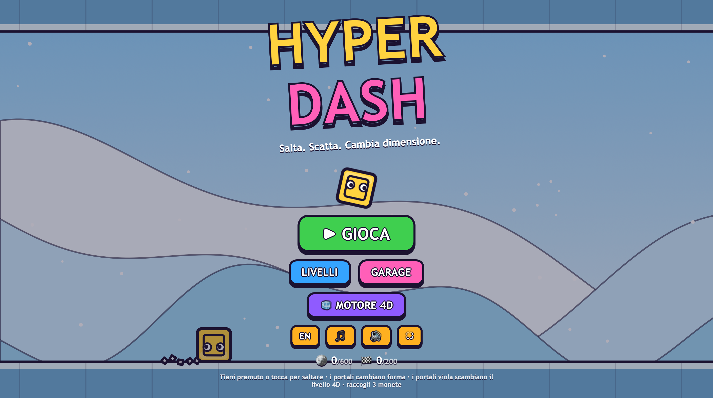
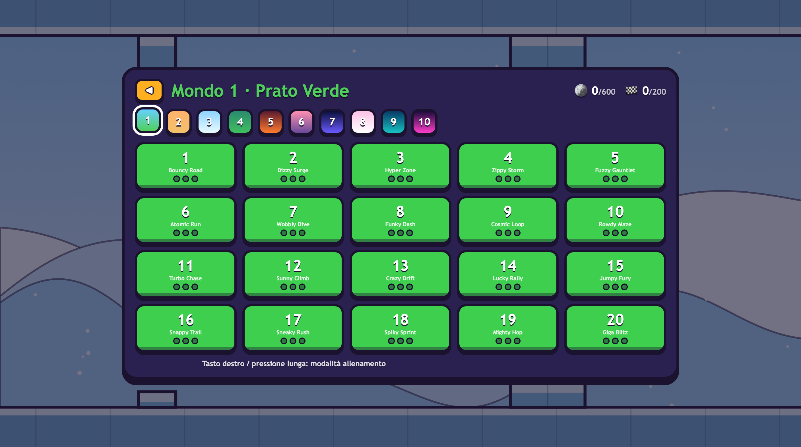
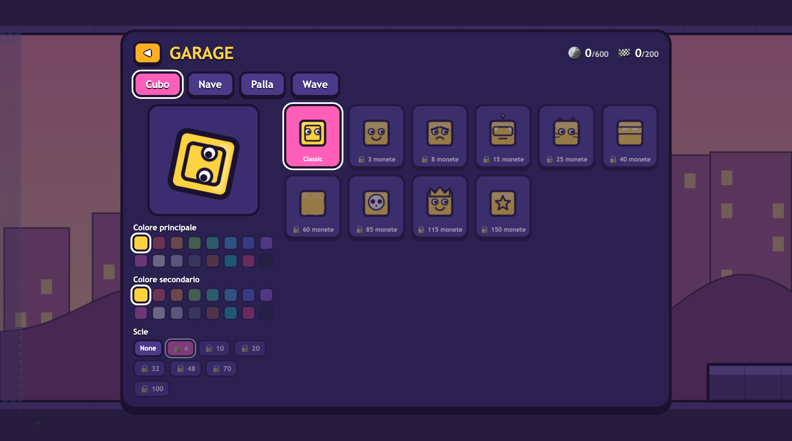
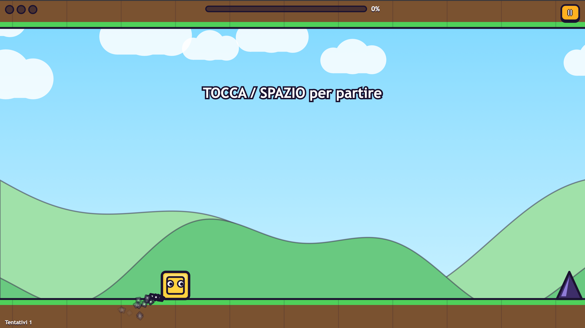

# HyperDash

<p align="center">
  <b>A 200-Level Platformer with a Fourth Dimension — Plus the From-Scratch 4D Engine Behind It</b>
</p>

<p align="center">
  <a href="https://github.com/nowii-core/hyperdash/blob/main/LICENSE">
    
  </a>
  
  
  
  
</p>

<p align="center">
  <a href="#overview">Overview</a> |
  <a href="#key-features">Features</a> |
  <a href="#tech-stack">Tech Stack</a> |
  <a href="#project-architecture">Architecture</a> |
  <a href="#quick-start">Quick Start</a> |
  <a href="#contact">Contact</a>
</p>

---

</div>

## Overview

**HyperDash** is a *Geometry-Dash-style* game in a hand-drawn cartoon look, with one twist nobody else has: **the fourth dimension is a gameplay mechanic**. Purple portals and dimension orbs swap the world between two layers — a wall that is solid in layer *A* is thin air in layer *B*.

It ships together with **HyperDimension**, the 4D graphics and physics engine written from scratch for the project: tesseracts, exact hyperplane slicing, 4D collisions, a W-axis puzzle mode, and a level editor. Everything runs in the browser from static files. No bundler, no server, no Node, no Python, no terminal.

---

## Preview

<p align="center">
  
  
</p>
<p align="center">
  
  
</p>

> **Live Demo:** [nowii-core.github.io/Hyperdash/hyperdimension-2/](https://nowii-core.github.io/Hyperdash/hyperdimension-2/)

---

## Key Features

- **200 Levels:** Spanning 10 themed worlds — Meadow, Desert, Ice, Jungle, Volcano, City, Space, Candy, Abyss, and the 4th Dimension.
- **4D Layer Mechanics:** Dimension portals and orbs swap layers (A ↔ B) mid-run, changing the level layout in real-time.
- **4 Playable Forms:** Cube, Ship, Ball, and Wave — switched via portals, with gravity, mini/big, and speed portals.
- **Proven Fairness:** Every level is generated procedurally and validated by a beam-search solver that plays the exact same deterministic engine. Only beatable levels ship.
- **Progression & Customization:** Collect 3 coins per level to unlock 40 skins (10 per form), 16 colors, and 8 trails.
- **HyperDimension Engine:** A custom 4D engine featuring 7 polytopes, 6-plane rotations, WebGL2 bloom rendering, 4D physics, and an editor with share links.
- **Procedural Audio:** Music and SFX generated entirely via WebAudio API — no audio files.
- **Zero Dependencies:** Built entirely with Vanilla JS, Canvas 2D, and WebGL2. Just double-click `index.html` and play.

---

## Tech Stack

### Frontend & Rendering
- **HTML5 & CSS3:** UI layout and styling for the game and 4D editor.
- **JavaScript (ES6+):** Deterministic game engine, procedural generation, and solver logic.
- **Canvas 2D & WebGL2:** High-performance rendering for the game visuals and 4D engine bloom effects.
- **Web Audio API:** Real-time procedural music and sound synthesis.

---

## Project Architecture

```text
hyperdash/
├── index.html          # Entry point for the game
├── css/                # Modular stylesheets (engine UI, game UI)
├── js/
│   ├── dash/           # Game-specific logic
│   │   ├── engine.js   # Deterministic game engine (forms, portals, layers)
│   │   ├── solver.js   # Beam-search solver for level validation
│   │   ├── generator.js# Procedural level generator
│   │   ├── leveldata.js# Validated chunk table & coins
│   │   ├── skins.js    # Skins, palettes, and themes
│   │   └── game.js     # Cartoon renderer, audio, loop, menus
│   ├── math4.js        # 4D math utilities
│   ├── polytopes.js    # Tesseracts and 4D geometry
│   ├── physics.js      # 4D physics
│   ├── gl.js           # WebGL2 wrapper
│   └── editor.js       # 4D level editor
├── tests/              # Engine tests and 200-level proof scripts
├── tools/              # Build scripts for level generation
└── docs/               # Documentation and assets
```

---

## Quick Start

### Run the Game
Simply **double-click `index.html`**. That's all. No build step, no installation, no server required.

### Developer Extras (Optional, requires Node 18+)
To run the test suite and prove all 200 levels are beatable:
```bash
node tests/all.js
```

To re-validate levels and regenerate the level data:
```bash
node tools/build-levels.js
```

### Controls
- **`Space` / `Up Arrow` / Click / Tap:** Jump & fly
- **`Esc`:** Pause
- **`R`:** Restart
- **`Z` / `X`:** Place / remove checkpoint (Practice mode)
- **`F`:** Fullscreen

---

## License

This project is distributed under the **MIT** license. See the [`LICENSE`](./LICENSE) file for more information.

---

## Contact & Support

- **Maintainer:** [@nowii-core](https://github.com/nowii-core)
- **Bug Reports & Feature Requests:** If you encounter an issue or would like to suggest an improvement, open an [Issue](https://github.com/nowii-core/hyperdash/issues) or submit a [Pull Request](https://github.com/nowii-core/hyperdash/pulls).

---

<div align="center">
  <sub>Developed by <b>nowii-core</b></sub>
</div>
