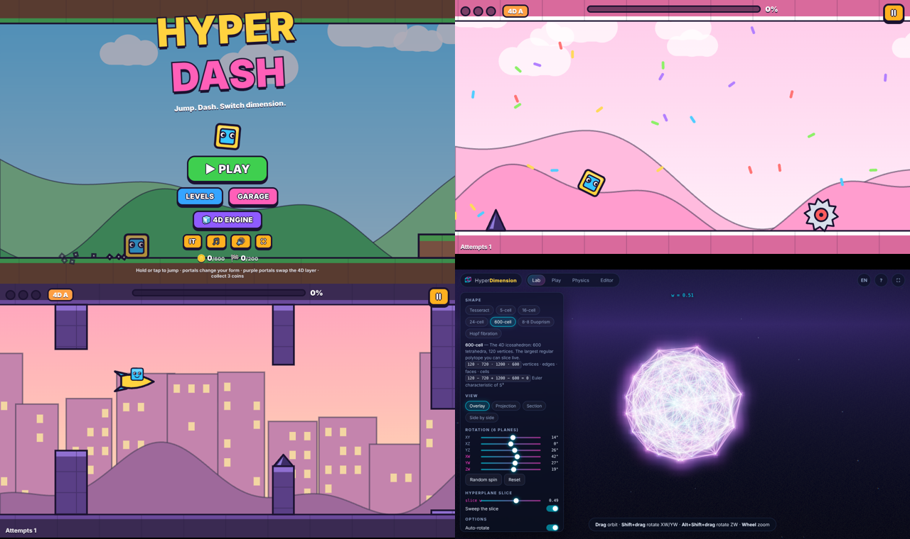

<div align="center">

# HyperDash

### A 200-level platformer with a fourth dimension — plus the from-scratch 4D engine behind it.

**Zero dependencies · Vanilla JS · Canvas 2D + WebGL2 · Double-click `index.html` and play**




[English](#english) · [Italiano](#italiano)

</div>

---

## English

### Overview
HyperDash is a *Geometry-Dash-style* game in a hand-drawn cartoon look, with one twist nobody else has: **the fourth dimension is a gameplay mechanic**. Purple portals and dimension orbs swap the world between two layers — a wall that is solid in layer *A* is thin air in layer *B*.

It ships together with **HyperDimension**, the 4D graphics and physics engine written from scratch for the project: tesseracts, exact hyperplane slicing, 4D collisions, a W-axis puzzle mode and a level editor.

Everything runs in the browser from static files. No bundler, no server, no Node, no Python, no terminal.

### Features
| | |
|---|---|
| **Levels** | 200 levels in 10 themed worlds — Meadow, Desert, Ice, Jungle, Volcano, City, Space, Candy, Abyss, 4th Dimension |
| **Forms** | Cube, Ship, Ball, Wave — switched by portals, plus gravity, mini/big and 4 speed portals |
| **Hazards & helpers** | Spikes, saws, blocks, jump pads, orbs (yellow / pink / blue / green / dimension) |
| **4D layers** | Dimension portals and orbs swap layer A ↔ B mid-run |
| **Progression** | 3 coins per level (600 total) unlock **40 skins** (10 per form), **16 colors**, **8 trails** |
| **Modes** | Normal, Practice (checkpoints), level select with per-level best and coins |
| **Audio** | Procedural music and SFX with WebAudio — no audio files |
| **Input** | Keyboard, mouse, touch · progress saved in `localStorage` |
| **4D engine** | 7 polytopes, 6-plane rotations, WebGL2 bloom renderer, 4D physics, puzzles, editor with share links |

### Why the 200 levels are fair
Levels are generated procedurally, chunk by chunk, and **every chunk is validated by a beam-search solver** that plays the exact same deterministic fixed-step engine (120 Hz) as the game, at a human-realistic 30 Hz input resolution. Only validated chunks ship. The reference solution of each level is stored, and the test suite replays all 200 in the real engine and checks that each one is completed with all 3 coins.

### Controls
`Space` / `↑` / click / tap — jump & fly · `Esc` — pause · `R` — restart · `Z` / `X` — place / remove checkpoint (practice) · `F` — fullscreen
Right-click or long-press a level to play it in Practice mode.

### Run
```text
Double-click index.html        ← that's all
```
Developer extras (optional, Node 18+):
```text
node tests/all.js              # engine tests + proof that all 200 levels are beatable
node tools/build-levels.js     # re-validate levels and regenerate js/dash/leveldata.js
```
Deploy: push to GitHub and enable **Pages** — a ready workflow is in `.github/workflows/pages.yml`.

### Architecture
```text
index.html
css/        style.css (4D engine UI) · dash.css (game UI)
js/dash/    engine.js     deterministic game engine (cube/ship/ball/wave, orbs, pads, portals, layers)
            solver.js     beam-search solver used to prove levels beatable
            generator.js  procedural level generator (pattern library, seeded)
            leveldata.js  validated chunk table + coins + reference solutions
            skins.js      40 skins, palettes, trails, 10 world themes
            game.js       cartoon renderer, audio, loop, menus, garage, practice mode
js/         math4 · polytopes · physics · gl · lab · play · sandbox · editor   (4D engine)
tests/      run.js · dash-engine.js · dash-levels.js · all.js
tools/      build-levels.js
```

### License
MIT — see [LICENSE](LICENSE).

---

## Italiano

### Panoramica
HyperDash è un gioco in stile *Geometry Dash* con grafica cartoon e una novità assoluta: **la quarta dimensione è una meccanica di gioco**. I portali viola e gli orb dimensionali scambiano il mondo tra due livelli: un muro solido nel livello *A* è aria nel livello *B*.

Include **HyperDimension**, il motore grafico e fisico 4D scritto da zero: tesseratti, sezioni iperpiane esatte, collisioni 4D, puzzle sull'asse W ed editor di livelli.

Tutto gira nel browser da file statici: niente bundler, server, Node, Python o terminale.

### Caratteristiche
- **200 livelli** in 10 mondi a tema
- **4 forme** (cubo, nave, palla, wave) + portali di gravità, taglia e velocità
- Spuntoni, seghe, blocchi, pad e orb
- **Livelli 4D** A ↔ B
- **3 monete per livello** → **40 skin**, 16 colori, 8 scie
- Modalità allenamento con checkpoint, musica ed effetti procedurali, touch/tastiera/mouse, progressi salvati
- **Tutti i livelli sono dimostrati superabili** da un solver automatico che usa lo stesso motore del gioco

### Avvio
Doppio click su `index.html`. Test (facoltativi): `node tests/all.js`.

### Licenza
MIT.
